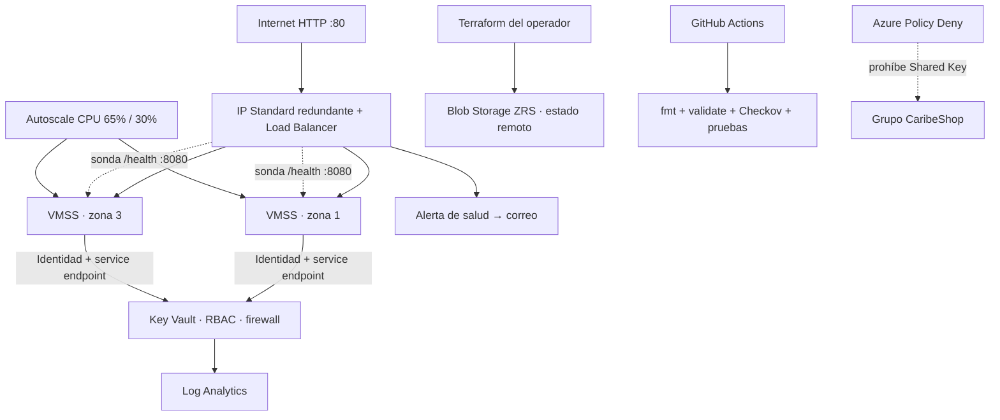

# CaribeShop · Parcial de Infraestructura para TI

Laboratorio de seguridad, autoscale y alta disponibilidad en Azure. Terraform crea la infraestructura y cloud-init inicia una app Python sin paquetes externos. No implementamos una tienda real: `/work` genera carga CPU reproducible y `/secret` demuestra acceso a Key Vault sin divulgar el valor.

**Estado:** implementación local. El despliegue, P1/P2/P3, el informe final y el video requieren una suscripción con crédito y evidencias reales. Las verificaciones locales no prueban el funcionamiento en Azure.

## Arquitectura



Las VMs no tienen IP pública. El NSG admite HTTP y sondas; rechaza las demás entradas y salidas, excepto HTTPS hacia Key Vault y Storage. DNS, IMDS y el canal del agente usan los mecanismos de plataforma de Azure. Storage se usa para el estado, en un grupo independiente; la app no necesita almacenar datos. La etiqueta Storage se permite para descargar Run Command y tiene un riesgo residual documentado.

## Archivos

- `infra/`: red, VMSS, secretos, política, autoscale y monitoreo.
- `bootstrap/`: Storage del backend; se ejecuta una vez y se migra su estado.
- `app/`: servidor y cloud-init. Rutas `/`, `/health`, `/work`, `/secret`.
- `locustfile.py`, `pruebas/`: carga, observación, análisis y pruebas locales.
- `docs/pruebas.md`: procedimiento para recoger las evidencias obligatorias.
- `docs/riesgos.md`: justificación de cada excepción de Checkov.
- `evidencias/`: únicamente resultados obtenidos al ejecutar las pruebas.

## Antes de desplegar

Necesitas Terraform 1.9 o superior (CI usa 1.16.1), Azure CLI, Python 3.12 o superior y una suscripción con crédito. El usuario que despliega necesita crear recursos, definiciones/asignaciones de Policy y asignaciones de roles. El VMSS solo recibe `Key Vault Secrets User` en su vault.

Comprueba que la sesión es de la cuenta elegida por el grupo. Si hay otra sesión en el equipo, usa un directorio independiente:

```bash
mkdir -p .local/azure
export AZURE_CONFIG_DIR="$PWD/.local/azure"
az login
az account list -o table
az account set --subscription ID_DE_LA_SUSCRIPCION
az account show --query '{cuenta:user.name,suscripcion:name,estado:state}'
```

Revisa el saldo en [Azure Sponsorships](https://www.microsoftazuresponsorships.com/Balance), las regiones permitidas y la cuota de **esa** suscripción. `canadacentral` es un ejemplo configurable, no una región garantizada.

```bash
az policy assignment list --disable-scope-strict-match -o json
az vm list-usage -l canadacentral -o table
az vm list-skus -l canadacentral --resource-type virtualMachines --size Standard_B --all -o json
az vm image list --location canadacentral --publisher Canonical \
  --offer ubuntu-24_04-lts --sku server-arm64 --all -o table
```

La configuración elegida usa B2pls_v2 (ARM64, 2 vCPU, 4 GiB), zonas 1 y 3, y máximo 3 instancias: 6 vCPU regionales. El catálogo consultado no indicó restricciones para ese tamaño; eso no garantiza capacidad al desplegar. Se requiere `EncryptionAtHostSupported`. Ese tamaño no admite Trusted Launch; el riesgo está documentado. El SKU debe permitir **al menos tres instancias** dentro de las cuotas regional y de familia. Si no alcanza, escoger otra talla/región o solicitar cuota. Para medir capacidad sostenida, preferir una serie sin créditos de CPU si la cuota lo permite. Fija una versión numérica de la imagen.

Registra, si hace falta, los proveedores `Microsoft.Compute`, `Microsoft.Network`, `Microsoft.Storage`, `Microsoft.KeyVault`, `Microsoft.Insights` y `Microsoft.OperationalInsights` con `az provider register --namespace NOMBRE --wait`. Terraform tiene el registro automático desactivado para evitar registros ajenos al proyecto. Comprueba también que la suscripción admite cifrado en host; si exige registrar `EncryptionAtHost`, completa ese requisito antes del plan.

## Estado remoto y despliegue

1. Copia `bootstrap/terraform.tfvars.example` a `bootstrap/terraform.tfvars`. Completa suscripción, región, nombre único de Storage e IPv4 pública del operador **sin /32**. Los archivos con datos reales están ignorados por Git.
2. Crea el backend y migra su estado inicial:

```bash
terraform -chdir=bootstrap init
terraform -chdir=bootstrap plan
terraform -chdir=bootstrap apply
terraform -chdir=bootstrap output -raw backend_config > infra/backend.hcl
cp bootstrap/backend.tf.example bootstrap/backend.tf
cp infra/backend.hcl bootstrap/backend.hcl
# Editar SOLO la key de bootstrap/backend.hcl: "bootstrap.tfstate".
terraform -chdir=bootstrap init -migrate-state -backend-config=backend.hcl
```

La primera creación no puede guardar su estado en una cuenta que aún no existe. Migra inmediatamente; verifica los blobs `bootstrap.tfstate` y `caribeshop.tfstate` después de los respectivos apply. Elimina las copias locales de estado tras comprobar la migración. No las publiques. Espera la propagación del rol `Storage Blob Data Contributor` si aparece un 403 inicial.

3. Copia `infra/terraform.tfvars.example` a `infra/terraform.tfvars`. Completa todos los campos. Genera la clave si no tienes una pública adecuada:

```bash
mkdir -p .local
ssh-keygen -t ed25519 -f .local/id_ed25519
cat .local/id_ed25519.pub
```

Pega solo la clave **pública** en `ssh_public_key`. En `infra`, `operator_ip` lleva `/32`. Define un correo real, una fecha futura de expiración y `max_instances` acorde a la cuota. Terraform genera el secreto; no se suministra por código ni por cloud-init. Su valor sí queda en el estado remoto.

```bash
terraform -chdir=infra init -backend-config=backend.hcl
terraform -chdir=infra plan
terraform -chdir=infra apply
curl "$(terraform -chdir=infra output -raw app_url)/health"
curl "$(terraform -chdir=infra output -raw app_url)/secret"
```

RBAC puede tardar varios minutos en propagarse. Si la creación del secreto falla con 403, revisa IP, rol y propagación y repite `apply`; no abras el firewall. `/health` mide la salud local; una caída de Key Vault afecta `/secret` y no elimina todas las VMs del balanceador.

## Validar localmente

```bash
python3 -m venv .venv
.venv/bin/python -m pip install -r requirements.txt
terraform fmt -check -recursive
terraform -chdir=bootstrap init -backend=false
terraform -chdir=bootstrap validate
terraform -chdir=infra init -backend=false
terraform -chdir=infra validate
.venv/bin/python .venv/bin/checkov -d . --config-file .checkov.yml --skip-download
.venv/bin/python -m unittest discover -s pruebas -p 'test_*.py' -v
```

Invocamos el script de Checkov mediante Python porque la ruta local contiene espacios. La app se prueba con `python3 app/server.py`; `/secret` requiere Azure y responderá 503 fuera de una VM con identidad. El resto funciona localmente.

## GitHub Actions

Cada PR ejecuta formato, validación de ambos proyectos, Checkov bloqueante y pruebas HTTP. No necesita credenciales de Azure. Los escaneos usan la misma versión de Checkov que el desarrollo local. No se usa `soft-fail` ni se ignoran hallazgos globalmente.

El workflow manual `Plan de Azure` corre solo desde `main`, en un runner propio con etiqueta `caribeshop`, Terraform y Azure CLI autenticada. Su IP debe estar autorizada en ambos firewalls. Crea el environment `azure-lab` y su variable `CARIBESHOP_CONFIG_DIR` con una ruta absoluta fuera del checkout que contenga `backend.hcl` y `terraform.tfvars`. No ejecutar código de PR en ese runner. El plan no aplica cambios ni publica el estado. Esto evita abrir los firewalls para runners públicos cambiantes.

## Destruir

```bash
terraform -chdir=infra plan -destroy
terraform -chdir=infra destroy
az resource list --resource-group rg-NOMBRE -o table
```

Si el grupo ya no existe, el último comando puede responder `ResourceGroupNotFound`: verificar también `az group exists --name rg-NOMBRE`. Key Vault conserva su registro borrado durante 7 días por purge protection; no intentar purgarlo. El backend permanece hasta terminar la entrega. Para eliminarlo, después de destruir `infra`, retira `bootstrap/backend.tf`, ejecuta `terraform -chdir=bootstrap init -migrate-state` para guardar su estado local temporalmente y luego `terraform -chdir=bootstrap destroy`. Guarda cualquier respaldo necesario fuera del repositorio y elimina las copias sensibles cuando ya no hagan falta.

## Línea base

Estas marcas indican controles implementados en código; la evidencia en Azure está pendiente.

- [x] Backend azurerm, estado y variables reales fuera de Git.
- [x] VMSS en dos zonas; sin IP pública ni entrada SSH/RDP.
- [x] Key Vault RBAC, purge protection, firewall y secreto con expiración.
- [x] Identidad del VMSS con lectura de secretos; no rol Contributor.
- [x] Policy Deny, auditoría, alerta por correo y reparación automática.
- [x] Autoscale con histéresis, cooldown e `ignore_changes = [instances]`.
- [x] Arranque automático y pipeline bloqueante.
- [ ] Despliegue verificado, P1/P2/P3 y pruebas negativas.
- [ ] Informe PDF final con datos propios y video grupal de 6–8 minutos.
- [ ] Recursos destruidos y limpieza verificada.
