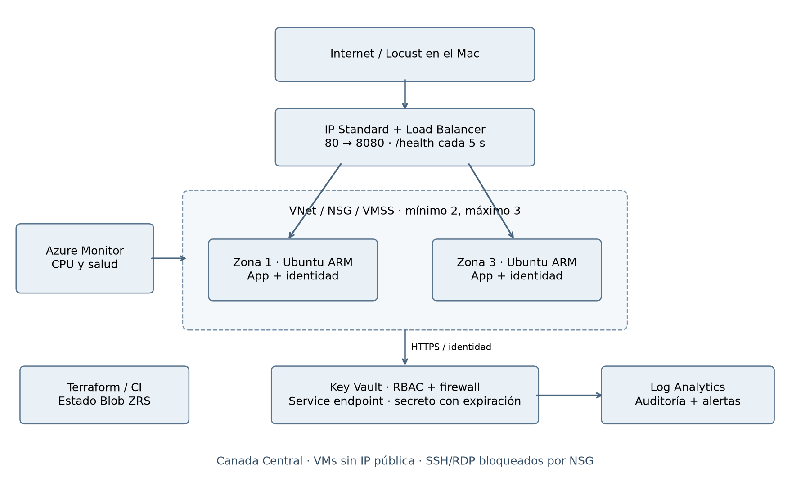
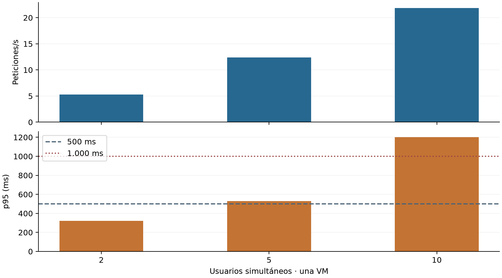
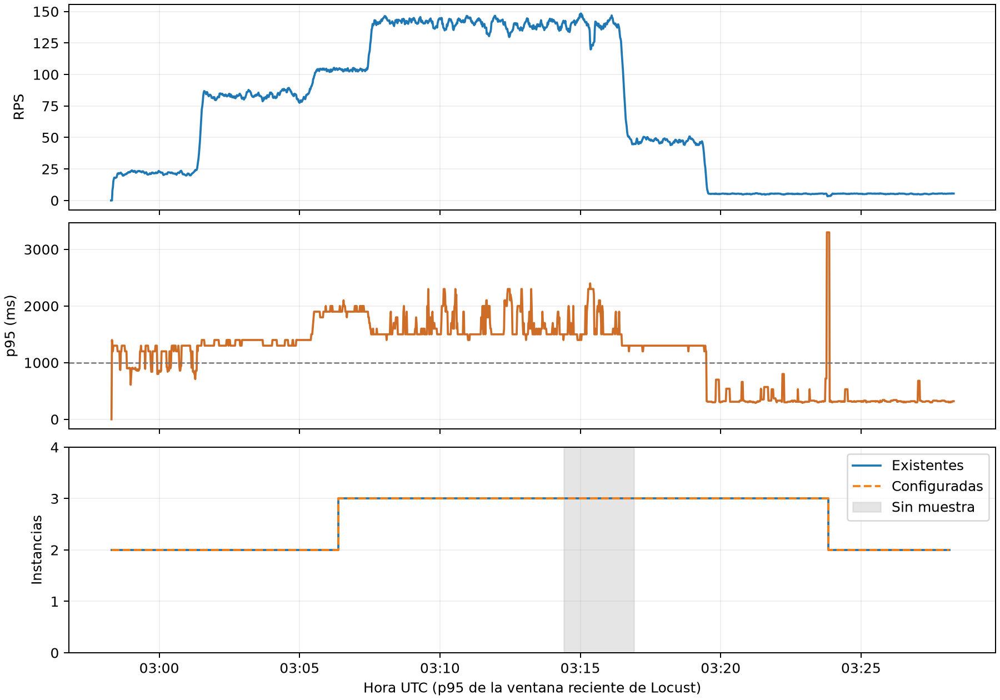

# CaribeShop

## Plataforma segura, escalable y altamente disponible

Universidad Tecnológica de Bolívar · Infraestructura para TI · Tercer parcial

**Isaac David Sánchez Sánchez**

**Santiago Andrés Orejuela Cueter**

**Luis Mario Díaz Martínez**

**Eli Weiman Amaya**

Docente: Rafael Enrique Monterroza Barrios

Pruebas: 23 de noviembre de 2026, hora de Colombia; 24 de noviembre en los registros UTC.

### Alcance y resultado

Se desplegó un laboratorio integrado en Azure mediante Terraform: VM Scale Set en dos zonas, balanceador Standard, identidad administrada, Key Vault, Azure Policy y observabilidad. La aplicación Python representa una carga sintética de CPU; no implementa un comercio electrónico con pedidos o base de datos.

La prueba escalonada completó 30 minutos, con aumento de dos a tres VMs y reducción posterior a dos. Se registraron 123.845 peticiones y cuatro errores. Las pruebas de falla midieron retirada del tráfico, reemplazo automático y recuperación de capacidad tras eliminación. Las pruebas negativas verificaron firewall, filtrado de salida y Policy Deny; Log Analytics confirmó lecturas del secreto por la identidad administrada. El pipeline rechazó el PR inseguro y aprobó su corrección.

La entrega conserva código, CSV, reportes HTML de Locust y respuestas originales de Azure. Los ensayos locales se mantienen separados de las evidencias cloud. Se destruyeron la infraestructura, el backend de estado y el Network Watcher auxiliar creado por Azure durante el despliegue. La consulta final de la suscripción no devolvió recursos activos.

**Repositorio:** [sorejuela/caribeshop-parcial](https://github.com/sorejuela/caribeshop-parcial). El informe es editable en `docs/informe.md`; los datos están en `evidencias/`.

**Video de la demostración:** [Ver grabación grupal en YouTube](https://youtu.be/JaoqaSU6ZuI). La grabación se realizó al finalizar las pruebas.

---
## 1. Arquitectura y decisiones

El balanceador publica HTTP 80 y lo dirige al puerto 8080 privado. El NSG permite únicamente ese tráfico y las sondas del servicio; bloquea SSH/RDP y el resto de entradas. Las VMs no tienen IP pública. El NSG de salida permite HTTPS a AzureKeyVault y Storage; el balanceador proporciona salida explícita. Storage es necesario para el canal de Run Command usado en las pruebas.

Se eligió **Canada Central, B2pls_v2 ARM64, 2 vCPU y 4 GiB**: la suscripción limita la región a seis vCPU y este tamaño estaba disponible en las zonas 1 y 3. El máximo de tres VMs respeta esa cuota. Se fijó Ubuntu 24.04 ARM, versión `24.04.202611170`; cloud-init usa Python instalado en la imagen, sin instalar paquetes desde Internet. El proceso corre sin root y con restricciones de systemd.

El estado usa un Storage ZRS independiente, RBAC de Entra ID, Shared Key deshabilitado y firewall limitado al operador. El vault permite la subred mediante service endpoint y la IP del operador; usa RBAC, purge protection y expiración del secreto. La identidad del VMSS tiene exclusivamente **Key Vault Secrets User** sobre ese vault. `/secret` devuelve la longitud, nunca el valor.

---
## 2. Trazabilidad de requisitos

| ID | Implementación | Evidencia en el repositorio |
|---|---|---|
| S1 | `bootstrap/`, `infra/versions.tf`, `.gitignore` | `configuracion/backend-remoto.json`; estados y variables reales excluidos de Git |
| S2 | `infra/network.tf`, `infra/compute.tf` | `configuracion/red.json`, `nsg.json`, `instancias.json` |
| S3 | `infra/security.tf`, `app/server.py` | `configuracion/lectura-secreto.json`, `vault.json`, `secreto-metadatos.json` |
| S4 | Rol de la identidad del VMSS | `configuracion/roles.json`: solo lectura de secretos |
| S5 | Policy Deny a Shared Key en Storage | `p3/policy-error.txt`: RequestDisallowedByPolicy |
| S6 | Diagnósticos de Key Vault | `configuracion/consulta-secreto.kql`, `auditoria-secreto.json` |
| E1 | VMSS en zonas 1 y 3, mínimo 2 | `configuracion/instancias.json`, `p1/instancias.csv` |
| E2 | Sonda HTTP `/health`, 5 s, dos fallos | `p2/salud-balanceador.json` |
| E3 | CPU, histéresis e ignore_changes | `p1/escalamiento.png`, `autoscale-historial.json` |
| E4 | Reparación automática Replace, PT10M | `p2/logica-instancias.csv`, `logica-eventos.json` |
| E5 | Alerta DipAvailability y correo | `configuracion/alertas.json`, `p2/alertas-historial.json` |
| D1 | `.github/workflows/ci.yml` | `devsecops.md`; PR #1 fallido y cerrado, PR #2 corregido y fusionado |
| D2 | Ocho omisiones Checkov justificadas | `docs/riesgos.md` y sección 8 del informe |
| D3 | `app/cloud-init.yaml.tftpl` | Nueva instancia sana y atendiendo tráfico sin configuración manual |

Las rutas de evidencias de la tabla son relativas a `evidencias/`. La evidencia corresponde exclusivamente al laboratorio del grupo. Los identificadores de recursos son metadatos, no credenciales; no se incluyen estados Terraform ni valores del secreto.

El backend se creó con estado local de arranque y se migró inmediatamente a azurerm. Se verificaron ambos blobs remotos antes de retirar el estado local inicial. Los planes con datos sensibles, llaves privadas y la sesión de Azure CLI permanecieron fuera de Git.

---
## 3. P1: capacidad de una instancia

Se fijó temporalmente el perfil en mínimo = máximo = 1 y se esperó una VM sana. Locust se ejecutó desde el Mac del operador contra la IP pública de Azure, en ensayos independientes de tres minutos. Cada usuario espera entre 50 y 150 ms entre solicitudes a `/work`; el servidor ejecuta PBKDF2-HMAC-SHA256 con 100.000 iteraciones fijas.

| Usuarios | Peticiones | RPS medios | p95 | Errores |
|---|---|---|---|---|
| 2 | 948 | 5,29 | 320 ms | 0 |
| 5 | 2.224 | 12,40 | 530 ms | 0 |
| 10 | 3.923 | 21,85 | 1.200 ms | 0 |

**El mayor nivel probado con p95 inferior a un segundo fue 12,40 RPS.** El nivel observado con p95 inferior a 500 ms fue 5,29 RPS. Son límites entre los escalones ensayados, no un máximo exacto ni una garantía de producción. El orden de ejecución fue 5, 10 y 2 usuarios; el último ensayo precisó el objetivo de 500 ms.

El p95 incluye Internet, establecimiento TCP y servicio: la aplicación usa conexiones HTTP/1.0 cerradas para observar nuevas decisiones de balanceo. No se atribuye toda la latencia a CPU. Las métricas agregadas de capacidad terminaron en 64,15 créditos; el CPU máximo por minuto fue 43,48 %. El p95 alto de diez usuarios no demuestra por sí solo saturación de CPU. La prueba mide `/work`, no el rendimiento de Key Vault. CSV, HTML, métricas CPU y créditos B permiten reproducir el análisis.

---
## 4. P1: escalamiento automático

El perfil normal usa mínimo 2 y máximo 3. Aumenta una VM si CPU media supera 65 % durante tres minutos, con cooldown de tres minutos; reduce una si baja de 30 % durante cinco minutos, con cooldown de cinco minutos. Los umbrales separados y la espera mayor para reducir evitan oscilaciones ante ruido corto. `ignore_changes = [instances]` permite que Azure gestione la capacidad sin que Terraform la revierta.

Locust ejecutó cinco tramos: 10 usuarios durante tres minutos, 50 durante cuatro, 100 durante once, 25 durante tres y 2 durante nueve. Duración total: 30 minutos. El observador consultó cantidad, capacidad, salud, identificadores y zonas aproximadamente cada 17 segundos; su intervalo incluye las llamadas al API.

Entre 02:58:16 y 03:28:18 UTC se completaron 123.845 solicitudes, cuatro fallidas (0,00323 %), 68,81 RPS medios y p95 global de 1.500 ms. Durante el tramo de 100 usuarios se atendieron 133,17 RPS de media y el p95 fue de 1.754 ms. El objetivo de 500 ms no se sostuvo a esa carga. La decisión 2 → 3 ocurrió a las 03:06:10; la VM nueva atendió a las 03:07:21: 70,55 s después de la decisión y 364,27 s desde el escalón de 50 usuarios. La reducción 3 → 2 se decidió a las 03:23:41 y se observó a las 03:23:50. Los créditos CPU mínimos por VM fueron 48,30, 44,54 y 50,05; ninguna agotó su saldo. Una consulta al API dejó un hueco de 149,71 s en el muestreo de instancias, sombreado en gris; Locust continuó registrando tráfico.

El gráfico alinea epoch UTC de Locust y Azure. La cantidad de VMs existentes no implica que todas estén listas: la columna `healthy` y la primera respuesta con `X-Instance-ID` permiten contrastar esa diferencia. Las métricas de Azure llegan con retraso de ingestión. No se mezclaron las fallas P2 con esta corrida.

---
## 5. P2: falla lógica y eliminación abrupta

Ambas pruebas comenzaron con dos VMs sanas. Se usó carga moderada de dos usuarios para que una sola VM pudiera atenderla. Cada petición registra hora UTC al finalizar, hostname, estado HTTP, error y duración. Los errores incluyen respuestas no satisfactorias y fallas de conexión de Locust.

### Falla lógica

Run Command creó la marca local `unhealthy`; desde ese momento `/health` y `/work` devolvieron 503. El inicio efectivo corresponde al reloj de la VM, impreso inmediatamente después de crear la marca. Se esperó la reparación automática Replace sin retirar manualmente el archivo.

La inyección ocurrió a las 04:24:26 UTC sobre la instancia 1. La última respuesta observada de ese hostname llegó 6,71 s después. Azure reemplazó la VM: desapareció su vmId original y apareció la instancia 4. Se observaron dos VMs sanas a las 04:37:09 UTC: 763,00 s después de la falla. No se retiró la marca ni se ordenó una reposición manual.

### Falla abrupta

Se eliminó explícitamente una VM durante carga. Se registraron el envío de la orden, su finalización y el momento en que volvieron a existir dos instancias sanas. Eliminar un recurso no equivale a dejar una VM no sana: se distingue la reposición del mínimo por autoscale de la reparación Replace de la prueba lógica.

La eliminación de la instancia 2 se solicitó a las 04:37:48 UTC y terminó a las 04:38:24 UTC. Se observaron nuevamente dos VMs sanas a las 04:39:30 UTC: 101,89 s desde el envío de la orden. La instancia nueva fue 5. La recuperación repuso el mínimo configurado sin ejecutar un escalamiento manual; se conserva el historial de autoscale para distinguirla de la reparación de la prueba lógica.

| Prueba | Ventana analizada | Peticiones | Errores y porcentaje |
|---|---|---|---|
| Lógica | hasta recuperación: 763,0 s | 2.573 | 12 (0,466 %) |
| Lógica | primeros 60 s: 60,0 s | 205 | 12 (5,854 %) |
| Abrupta | hasta recuperación: 101,9 s | 362 | 2 (0,552 %) |
| Abrupta | primeros 60 s: 60,0 s | 188 | 2 (1,064 %) |

La última respuesta de la instancia afectada aproxima su retiro del tráfico, pero incluye el tiempo de la petición y no identifica conexiones sin respuesta. El muestreo de salud añade una incertidumbre de aproximadamente un intervalo. Se reporta además una ventana fija de 60 segundos desde cada inyección para comparar sin diluir errores en toda la corrida.

El historial de Azure Monitor conserva la activación de la alerta de salud y sus estados. El receptor de correo figura habilitado en el grupo de acciones. La evidencia es el historial exportado; no se usa la habilitación del receptor como prueba de entrega de cada correo.

---
## 6. P3 y DevSecOps

### Tres controles probados

**Red de Key Vault.** El operador leyó el identificador del secreto con su rol válido; se retiró únicamente su IP del firewall y se repitió la lectura con la misma identidad. Azure respondió `ForbiddenByFirewall`. Se repuso la IP en un bloque de restauración y la lectura volvió a funcionar. La subred de las VMs permaneció autorizada. El experimento aísla la variable de red; no usa un usuario sin permisos como prueba de firewall.

**Salida restringida.** Desde la VM se resolvió `example.com` a direcciones IPv4. Los intentos TCP a 443 agotaron cinco segundos y curl devolvió código 28. La lectura local de `/secret` siguió respondiendo longitud 32. El resultado, junto al NSG, demuestra el bloqueo hacia ese destino; no prueba bloqueo de todos los destinos incluidos en las etiquetas Azure permitidas.

**Gobierno.** Se intentó crear una cuenta de Storage con Shared Key dentro del grupo protegido. Azure rechazó la solicitud con `RequestDisallowedByPolicy` y señaló la asignación `deny-storage-keys`. La cuenta de prueba no llegó a crearse.

### Auditoría y pipeline

Log Analytics registra operaciones SecretGet exitosas con el object ID 5260149d-3be1-4fa4-9c56-0c6a749812df y el identificador del VMSS en identity_claim_xms_mirid_s. La consulta filtra identity_claim_oid_g por esa identidad y proyecta fecha, operación, resultado y recurso solicitante. Se conservan la consulta y la respuesta original, sin valores del secreto.

El pipeline ejecuta fmt, validate, pruebas de la aplicación y Checkov bloqueante. El [PR #1](https://github.com/sorejuela/caribeshop-parcial/pull/1) introdujo SSH abierto a Internet y falló por `CKV_AZURE_10`; se cerró sin fusionar y nunca se desplegó. El [PR #2](https://github.com/sorejuela/caribeshop-parcial/pull/2) retiró ese hallazgo, pasó y fue fusionado. Las URL de ejecuciones están en `evidencias/devsecops.md`.

Checkov evalúa código antes de desplegar; Policy evalúa solicitudes sobre Azure, incluso cambios manuales. Ninguno reemplaza al otro: el pipeline no intercepta todas las modificaciones fuera de Git y una Policy específica no cubre todas las reglas estáticas.

---
## 7. SLA compuesto y falla regional

El SLA oficial de noviembre de 2026 establece 99,99 % para conectividad de VMs distribuidas en dos o más zonas; 99,99 % para Load Balancer Standard con al menos dos VMs sanas; y 99,99 % para Key Vault. Se usa la disponibilidad del conjunto multizona, sin suponer que dos VMs tienen fallas independientes.

| Ruta | Modelo simplificado | Disponibilidad estimada | Indisponibilidad en 30 días |
|---|---|---|---|
| `/work` | 0,9999 × 0,9999 | 99,980001 % | 8,64 minutos |
| `/secret` | 0,9999 × 0,9999 × 0,9999 | 99,970003 % | 12,96 minutos |

Se multiplican componentes en serie como aproximación de diseño; `(1 − A) × 43.200` convierte disponibilidad en minutos. No es un SLA contractual propio ni una predicción medida. Se omiten Internet del cliente, errores de la aplicación e identidad/IMDS, para los que aquí no se estableció un factor contractual independiente. El cálculo no caracteriza la fase temporal de una sola VM ni garantiza cobertura de una oferta estudiantil.

El estado Terraform y Log Analytics no participan en la respuesta de `/work`. Key Vault sí es dependencia adicional de `/secret`, que consulta por petición. Por esa razón la sonda solo evalúa el proceso local: una falla compartida del vault no debe retirar todas las VMs del balanceador.

### Punto de falla común y costo de eliminarlo

La región sigue siendo un dominio de falla común. El balanceador es un servicio administrado redundante, no una VM individual. Una caída regional afecta simultáneamente cómputo y entrada pública; repetir el mismo código defectuoso también afecta todas las réplicas.

Una segunda región con dos VMs, vault independiente, sincronización de secretos y enrutamiento global reduciría ese riesgo. Una base en East US 2 con dos B2pls_v2, discos S4, LB, IP pública y Traffic Manager para dos endpoints y un millón de consultas DNS suma aproximadamente 75,29 USD/mes adicionales. Hay que añadir logs, operaciones y transferencia según uso; no se duplica el tramo gratuito de logs. Las tarifas están conservadas en el anexo de costos. Esa alternativa requiere validar cuotas, disponibilidad, DNS, conmutación y consistencia; no fue desplegada ni ensayada en este laboratorio. La app actual no tiene datos de pedidos que replicar.

Fuente: [SLA oficial de Microsoft, noviembre de 2026](https://www.microsoft.com/licensing/docs/view/Service-Level-Agreements-SLA-for-Online-Services). [Confiabilidad de Key Vault](https://learn.microsoft.com/en-us/azure/reliability/reliability-key-vault).

---
## 8. Riesgos aceptados

Hay ocho omisiones Checkov, agrupadas en siete decisiones. Todas tienen un comentario junto al recurso y una justificación ampliada en `docs/riesgos.md`.

| Riesgo / regla | Impacto aceptado | Mitigación |
|---|---|---|
| R1 · CKV_AZURE_33 | Sin auditoría Queue; el servicio no se utiliza | Shared Key deshabilitado; activar diagnósticos si se incorpora Queue |
| R2 · CKV_AZURE_59 y CKV2_AZURE_33 | Backend público, sin Private Endpoint; compromiso de la IP autorizada | Firewall Deny, operador /32, Entra ID y TLS; runner y red privados en producción |
| R3 · CKV_AZURE_206 | ZRS no protege frente a pérdida regional del estado | Versiones y soft delete; evaluar GZRS y recuperación regional |
| R4 · CKV_AZURE_36 | Bypass AzureServices deshabilitado; un servicio legítimo puede quedar bloqueado | Permitir únicamente una excepción concreta si resulta necesaria |
| R5 · CKV2_AZURE_1 | Cifrado con claves de Microsoft; menor control sobre su ciclo de vida | Cifrado de infraestructura; CMK independiente si se exige control propio |
| R6 · CKV2_AZURE_21 | Lecturas del estado Blob sin auditoría del plano de datos | RBAC y firewall; añadir diagnósticos en producción. Versionado no detecta lecturas |
| R7 · CKV2_AZURE_32 | Vault con service endpoint, sin Private Endpoint | Firewall de subred y operador, RBAC y HTTPS; sin bypass general |

### Límites adicionales

HTTP y `/work` son públicos y sin autenticación, por lo que solo se usan datos sintéticos. Producción necesita TLS, límites de tráfico y protección de aplicación. Las etiquetas Storage y AzureKeyVault permiten otros destinos de Azure: no eliminan toda vía de exfiltración.

La serie B usa créditos CPU; los resultados no prueban rendimiento ilimitado sostenido. El tamaño elegido no admite Trusted Launch, aunque usa cifrado en host. La imagen oficial está fijada y no descarga actualizaciones al iniciar; debe renovarse periódicamente. La sonda no detecta fallas del vault y no hay recuperación multirregional propia.

Si un atacante ejecuta código en la VM, puede usar IMDS y leer los secretos autorizados. El rol no permite escribirlos, asignarse permisos ni administrar recursos. La red y el proceso sin root reducen posibilidades, pero no impiden que exfiltre hacia destinos permitidos. Esta es una limitación residual explícita del laboratorio.

---
## 9. Costos mensuales y ahorro

Escenario de producción ilustrativo: 730 horas, tres VMs B2pls_v2, discos HDD S4, 100 GB procesados por el LB, hasta 100 GB de salida a Internet, 10 GB de logs, 100.000 operaciones de secretos y 1 GiB de estado con versiones. Tarifas USD de Canada Central, pago por uso, consultadas el 23 de noviembre de 2026. El descuento estudiantil no se aplica al presupuesto.

| Componente | Supuesto | USD/mes |
|---|---|---|
| VMs | 3 × 730 h × 0,0368 | 80,5920 |
| Discos | 3 S4 de hasta 32 GiB | 5,0700 |
| Balanceador | Hasta cinco reglas | 18,2500 |
| IP pública | 730 h × 0,005 | 3,6500 |
| Datos LB y operaciones de disco | 100 GB y un millón de operaciones | 0,5500 |
| Estado Blob ZRS y operaciones | 1 GiB; 10.000 lecturas y escrituras | 0,0982 |
| Key Vault | 100.000 operaciones | 0,3000 |
| Logs | (10 − 5 GB incluidos) × 2,76 | 13,8000 |
| Alertas, correos y salida | Dentro de cantidades gratuitas disponibles | 0,0000 |
| **Total con tres VMs fijas** | | **122,31** |

Dos VMs durante 600 horas y tres durante 130 horas equivalen a 1.590 VM-horas. Manteniendo los demás supuestos, el costo sería **98,84 USD/mes**, ahorro de **23,47 USD (19,2 %)**. Dos VMs fijas costarían **93,76 USD/mes**. Esta distribución horaria es una hipótesis y no una extrapolación del ensayo de 30 minutos.

Los tramos gratuitos se suponen disponibles en la cuenta. Tráfico, logs y operaciones mayores cambian el costo; no se incluyen impuestos, soporte, dominio, WAF ni base de datos. Los detalles y las tarifas originales consultadas de la calculadora están en `docs/costos.md` y `evidencias/costos/tarifas.json`.

El laboratorio se autorizó con un límite de 5 USD de crédito. El costo mensual anterior es un escenario de producción, no el gasto de esta sesión ni una factura del consumo real. Los componentes base, con hasta tres VMs, LB, IP y discos, cuestan aproximadamente 0,15 USD por hora; logs y operaciones se consideran aparte. La cuota de ingestión se limitó a 1 GB diario. El cierre del laboratorio se verifica en la sección 10 y en la evidencia de limpieza.

Fuentes: [Calculadora Azure](https://azure.microsoft.com/pricing/calculator/), [VMs](https://azure.microsoft.com/en-us/pricing/details/virtual-machines/linux/), [discos](https://azure.microsoft.com/en-us/pricing/details/managed-disks/), [Blob](https://azure.microsoft.com/en-us/pricing/details/storage/blobs/), [Monitor](https://azure.microsoft.com/en-us/pricing/details/monitor/), [Key Vault](https://azure.microsoft.com/en-us/pricing/details/key-vault/), [bandwidth](https://azure.microsoft.com/en-us/pricing/details/bandwidth/).

---
## 10. Análisis y cierre

### 300 RPS con p95 inferior a 500 ms

El escalón medido fue `r500 = 5,285 RPS`. Con un margen de utilización de 80 %, `ceil(300 / (5,285 × 0,8)) = 71` instancias; tolerar la pérdida de una exige al menos 72. Para soportar una zona completa caída haría falta dimensionar la zona superviviente, no solo añadir una VM.

Con 71 B2pls_v2 serían 142 vCPU, frente a una cuota regional actual de seis; no es viable. La fórmula es una extrapolación conservadora de un ensayo externo y una carga sintética, no una recomendación de desplegar 71 máquinas. Primero se debe perfilar la aplicación, separar latencia de red de servicio, probar conexiones persistentes y medir un tamaño sin créditos CPU desde un generador controlado. Después se dimensiona y se solicita la cuota necesaria.

### Pico súbito a las 20:00

El aumento observado tardó 364,27 s desde el escalón de 50 usuarios hasta la primera respuesta de la nueva VM: unos 293,71 s hasta la decisión y 70,55 s de provisión y arranque. Ese retardo incluye agregación de métricas y evaluación, no solo el umbral de tres minutos. Para una campaña conocida a las 20:00, programaría un mínimo mayor antes del evento con margen basado en el arranque medido, mantendría autoscale reactivo para variaciones y reduciría después con cooldown. El máximo de tres VMs no resuelve 300 RPS con esta medición: antes hay que optimizar y obtener cuota. Autoscale predictivo puede ayudar con patrones recurrentes de CPU, pero requiere historial suficiente y validación; no sustituye un perfil programado para el primer evento ni fue ensayado aquí. [Referencia: autoscale predictivo de Azure](https://learn.microsoft.com/en-us/azure/azure-monitor/autoscale/autoscale-predictive).

### Estado Terraform y posible filtración

Se protegió con RBAC, firewall, TLS, cifrado de infraestructura, ZRS, versionado y soft delete. El secreto generado existe dentro del estado; `sensitive` solo oculta su presentación. Una filtración exige rotar el secreto, revisar accesos y versiones comprometidas y valorar el resto de información expuesta. No entrega automáticamente la identidad administrada, pero el secreto debe tratarse como comprometido.

Las preguntas de punto común de falla, ejecución de código malicioso y complementariedad de controles se desarrollaron en las secciones 7, 8 y 6, respectivamente.

### Evidencias, destrucción y video

Se ejecutó terraform destroy para la aplicación y, después de migrar temporalmente el estado del bootstrap a local, se destruyó también el backend. Azure confirmó que rg-csorejuela26, rg-caribeshop-state y NetworkWatcherRG no existen. Se eliminó también la definición de Policy del laboratorio y se verificaron ambos estados Terraform sin recursos administrados. La consulta final no devolvió recursos activos; la evidencia está en evidencias/configuracion/limpieza.json. La retención del vault borrado por purge protection no equivale a cómputo activo; no se intentó purgarlo. Los resultados y la comprobación de limpieza están versionados.

La demostración audiovisual complementa los CSV, los reportes HTML y las respuestas de Azure conservados en el repositorio.

Referencias operativas: [reparación automática VMSS](https://learn.microsoft.com/en-us/azure/virtual-machine-scale-sets/virtual-machine-scale-sets-automatic-instance-repairs), [reglas de salida del LB](https://learn.microsoft.com/en-us/azure/load-balancer/outbound-rules), [Bpsv2 y créditos](https://learn.microsoft.com/en-us/azure/virtual-machines/sizes/general-purpose/bpsv2-series). Cada resultado numérico del informe remite a los archivos del repositorio y a ventanas UTC declaradas.
